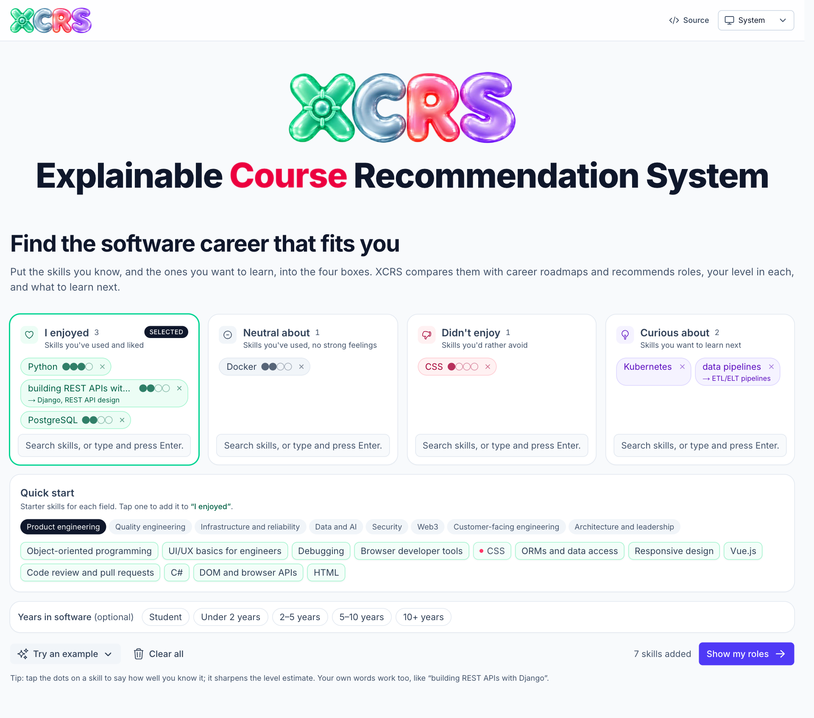
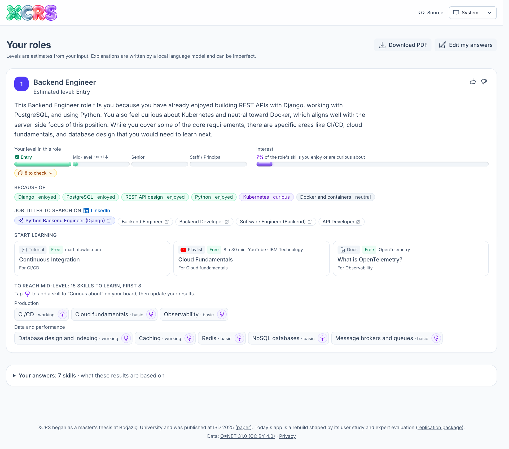

<p align="center">
  <a href="https://xcrs.app"></a>
</p>

<h1 align="center">Explainable Career · Course · Concept Recommendation System</h1>

<p align="center"><b>Find the software career that fits you, and what to learn next.</b><br>
<a href="https://xcrs.app">xcrs.app</a></p>

XCRS recommends **career roles** and **free learning resources** based on what you have already learned and what you are curious about, and explains **why** it recommends each one, in plain language built from your own input.

> **Live at [xcrs.app](https://xcrs.app).** XCRS runs self-hosted on two VMs; the same app also runs on AWS at [aws.xcrs.app](https://aws.xcrs.app). The original 2024 research prototype is preserved at the tag [`research-prototype`](https://github.com/yasinhorasanli/XCRS/tree/research-prototype) and in the [Zenodo release](#research-origin--citation).

**Tell it what you know:** skills from the catalog or in your own words, in four boxes, with an optional 1–4 rating.

<picture>
  <source media="(prefers-color-scheme: dark)" srcset="docs/images/home-dark.png">
  
</picture>

**See roles, your level, what to learn and why:** an explanation built from your own input, your place on the role's level ladder, job titles to search for, free resources, and the skills that lead to the next level.

<picture>
  <source media="(prefers-color-scheme: dark)" srcset="docs/images/results-dark.png">
  
</picture>

## How it works

You sort skills into four boxes (search the catalog, click a suggestion, type your own words, or import them from your CV), optionally rating how well you know each one (1–4):

| Box | Meaning | Weight |
|---|---|---|
| Curious about | Things you want to learn | `1.0` |
| I enjoyed | Things you studied and liked | `1.0` |
| Neutral about | Things you studied, no strong feelings | `0.5` |
| Didn't enjoy | Things you studied and would rather avoid | `-0.5` |

XCRS then:

1. **Reads your words as catalog skills.** Picked chips are exact; typed text goes through a name lookup, then a local LLM picks from the catalog and embedding similarity confirms the pick ([ADR-0030](docs/adr/0030-skill-matching-lookup-llm-pick-confirmed-by-similarity.md)).
2. **Scores 30 career roles** as a blend of interest (how much of what you enjoy or are curious about the role relies on) and coverage (how much of the role you already have), with an estimated level on the role's entry → staff ladder and the gaps to the next one in learning order ([ADR-0031](docs/adr/0031-engine-v2-role-scoring-calibrated-blend.md)). It shows up to three roles, and only those your board gives real evidence for ([ADR-0052](docs/adr/0052-show-only-roles-the-board-gives-evidence-for.md)), with the job titles to search for ([ADR-0044](docs/adr/0044-job-titles-per-role-and-one-for-the-learner.md)).
3. **Suggests free resources** for each role's first gaps: curated documentation and courses, freeCodeCamp courses, and one approved YouTube playlist or long video, linked to the right chapter ([ADR-0033](docs/adr/0033-first-learning-resource-sources.md), [ADR-0038](docs/adr/0038-one-video-slot-in-each-roles-resources.md), [ADR-0046](docs/adr/0046-youtube-long-videos-sections-and-channel-discovery.md)).
4. **Explains** each role with a local LLM, given only the facts the engine used. The result returns at once; explanations arrive in the background ([ADR-0037](docs/adr/0037-engine-v2-becomes-the-main-site-with-grounded-explanations.md)).

Without an account nothing is stored in your browser beyond the board itself, and no cookies are set. Signing in (GitHub, Google or LinkedIn) keeps your board and results across devices ([ADR-0043](docs/adr/0043-accounts-with-social-sign-in-in-the-nuxt-server.md)), and lets you **import skills from a CV or LinkedIn PDF**. The file is read for visible text only, one local LLM call suggests skills with years and levels, and you review every suggestion before it reaches the board. Nothing from the file is stored ([ADR-0045](docs/adr/0045-skills-from-a-cv-or-linkedin-pdf.md)).

The catalog (259 skills, 30 roles on an entry → staff ladder, roadmaps per role and level, 257 curated resources) is YAML in [`catalog/`](catalog), reviewed as pull requests and checked against O*NET and ESCO. Adapters add freeCodeCamp courses and approved YouTube playlists and videos; over 450 resources in all are tagged with skills.

## Architecture

```
Browser ──► Cloudflare Tunnel ──► Caddy ──► Nuxt 4 (skill board, results, sign-in; proxies /api/v2/**)
                                                │
                                                ▼
                 FastAPI /api/v2  ──  api/ → services/ → pure domain/ + adapters
                   ├─ skill matching ──► Ollama  qwen3-embedding:0.6b + the LLM
                   ├─ CV import (visible PDF text, one LLM call, in-memory jobs) ──► Ollama
                   ├─ explanations (background worker, LangChain) ──► Ollama  qwen3.5:9b (GPU) / 4b (CPU)
                   └─ repository ──► PostgreSQL + pgvector (catalog schema, ingest schema, activity, job queue)
```

| Folder | Stack | Purpose |
|---|---|---|
| [`backend/`](backend) | Python 3.13, FastAPI, SQLAlchemy, Alembic, LangChain, uv | API, engine, explanation worker, admin CLI (`xcrs`), evaluation tools (`eval/`) |
| [`frontend/`](frontend) | Nuxt 4, Nuxt UI 4, Tailwind 4 | Skill board, results, accounts (social sign-in in the Nuxt server), CV import |
| [`catalog/`](catalog) | YAML | Skills graph, career roles with levels and paths between them, roadmaps, curated resources |
| [`deploy/`](deploy) | Compose, Caddy, systemd | The two-VM deployment, backups |
| [`infra/`](infra) | Terraform | The AWS copy and the Cloudflare setup, as code |
| [`docs/`](docs) | Markdown | [Decision records](docs/adr/README.md), [architecture](docs/architecture.md), [schema](docs/schema.md), [measurements](docs/baseline.md) |

## Run it locally

```bash
brew install ollama uv
ollama serve &                                # Ollama runs natively (uses the Apple GPU)
ollama pull qwen3-embedding:0.6b
ollama pull qwen3.5:9b                        # explanations; on a CPU-only machine: qwen3.5:4b (ADR-0020)
cp .env.example .env
docker compose up -d postgres

cd backend
uv sync
uv run alembic upgrade head                   # create the schema
uv run xcrs register-model qwen3-embedding:0.6b --id 1 --status active
uv run xcrs catalog import && uv run xcrs catalog embed   # catalog/ → Postgres, skill vectors
uv run xcrs resources ingest freecodecamp && uv run xcrs resources tag   # optional: adapter resources
uv run pytest

uv run uvicorn xcrs.api.app:app --port 8000   # API docs: http://localhost:8000/docs
cd ../frontend && pnpm install && pnpm run dev # UI:       http://localhost:3000
```

Everything in containers (as on the servers), with Ollama still native:

```bash
docker compose --profile app up -d --build    # postgres + api (:8000) + web (:3000)
docker compose run --rm api alembic upgrade head
```

**Backups** of PostgreSQL (the activity data can't be rebuilt; the catalog can):

```bash
scripts/db-backup.sh                     # compressed dump + manifest (row counts, checksum) in backups/, keeps 14
scripts/db-verify-backup.sh              # restores the newest dump into a throwaway container and compares
scripts/db-restore.sh DUMP xcrs_copy     # restore into a new database (--replace to overwrite the live one)
```

Backups stay on the machine that made them; `scripts/db-offsite-copy.sh` copies them to another host (on the VMs a nightly systemd timer does both, ADR-0036).

**Deployment** to the two VMs (images from GHCR, Caddy, a deploy script with backup and smoke test): see [deploy/README.md](deploy/README.md).

**CI** (GitHub Actions) runs Ruff, the migrations (up, down, up), the tests, the frontend type check and build, and both image builds on every push. **Evaluation** (`backend/eval/`): `bench_skill_matching.py` (349 labeled phrases), `bench_role_scoring.py` (53 learner profiles), `bench_role_gate.py` (which roles to show), `bench_cv_import.py` (labeled synthetic CVs: skills found, experience band, speed) and `bench_explainer.py` (explanation speed and grounding per model and device).

## Research origin & citation

XCRS began as a master's thesis at Boğaziçi University and was published at ISD 2025 ([paper](https://doi.org/10.62036/ISD.2025.133)). The research prototype compared five embedding providers side by side, with `gpt-4o` explanations and a user study. That prototype is preserved at the tag [`research-prototype`](https://github.com/yasinhorasanli/XCRS/tree/research-prototype) (`Zenodo-v1.0` is the archived release), and the replication package (code, data, the user-study protocol, questions and responses) is archived on Zenodo:

[](https://doi.org/10.5281/zenodo.14291086)

## Credits

- Occupations and technologies: [O*NET 31.0](https://www.onetcenter.org/database.html) by USDOL/ETA (CC BY 4.0) and [ESCO](https://esco.ec.europa.eu) (attribution in [`catalog/README.md`](catalog/README.md))
- Courses: [freeCodeCamp](https://www.freecodecamp.org) (curriculum BSD-3-Clause) and the providers linked in `catalog/resources.yaml`; videos from YouTube
- The research prototype used [roadmap.sh](https://roadmap.sh) roadmaps and Udemy courses

## License

- Code: [Apache-2.0](LICENSE) (see [`NOTICE`](NOTICE)).
- Catalog data (`catalog/`): [CC BY 4.0](catalog/LICENSE); credit "XCRS catalog" with a link to this repository.
- Third-party content keeps its own terms: O\*NET and ESCO data (see [`catalog/README.md`](catalog/README.md)), the linked courses, and YouTube titles and metadata (YouTube Terms of Service).
- Versions up to the tag `research-prototype` (and the Zenodo release) were published under GPL-3.0-or-later and stay so. The license changed in [ADR-0053](docs/adr/0053-apache-2-0-code-and-cc-by-4-0-catalog.md).
